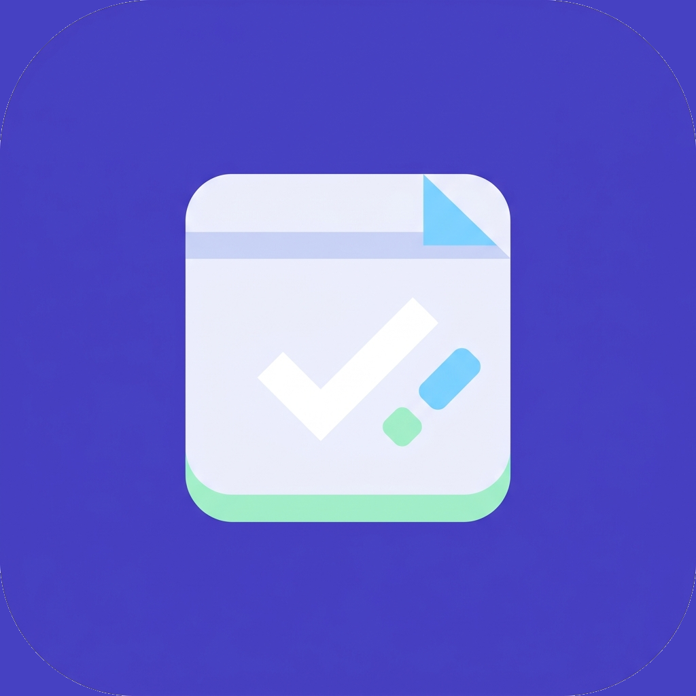

<div align="center">
  
  <h1>Kronoza</h1>
  <p><strong>A native Android calendar and task planner with local-first storage.</strong></p>
</div>

Kronoza brings calendar events, tasks, reminders, and activity insights together in an Android app built with Kotlin and Jetpack Compose. Its working data is stored on the device; no account or network permission is required for the app's core features.

## Screenshots

No screenshots captured from a running device or emulator are currently included. The images in [`assets/design-references/aistudio/`](assets/design-references/aistudio/) are retained design references, not product screenshots. See the [screenshot guide](docs/SCREENSHOTS.md) for how to add genuine, privacy-safe captures.

## Features

- Month, week, day, and agenda calendar views, including multi-day and recurring events.
- Event editing with occurrence/series handling and schedule-overlap feedback.
- Tasks with due dates, priorities, categories, subtasks, filtering, and sorting.
- Scheduled event and task reminders using Android alarms with WorkManager scheduling support and system-event rescheduling.
- Search across schedule and task data, plus productivity summaries calculated from local records.
- JSON backup and restore, with merge or replace modes and a SHA-256 integrity check.
- Theme and calendar preferences, optional local profile details, and avatar selection through Android's Photo Picker.

## Technology

| Area | Implementation |
| --- | --- |
| Language and UI | Kotlin 2.4.21, Jetpack Compose (BOM 2024.09.00), Material 3 |
| Navigation | Navigation Compose 2.8.9 |
| App architecture | Single-activity UI, ViewModel and repository layers |
| Local persistence | Room 2.7.0 (SQLite), DataStore Preferences 1.1.7 |
| Reminders and concurrency | WorkManager 2.10.0, AlarmManager, Kotlin Coroutines 1.10.2 |
| Build | Gradle 9.3.1 Wrapper, Android Gradle Plugin 9.1.1, KSP 2.3.5 |

Dependency versions are maintained in [`gradle/libs.versions.toml`](gradle/libs.versions.toml). The current app configuration uses Android SDK 36, a minimum SDK of 24, and Java 11 source/target compatibility.

## Architecture

Compose screens render state exposed by `KronozaViewModel`. The ViewModel delegates persisted operations to `KronozaRepository`, which coordinates the Room database, preferences, reminder scheduling, and JSON backup/restore. See [Architecture](docs/ARCHITECTURE.md) for the module and data-flow details.

## Data storage

Events, tasks, reminder configurations, and in-app notification records are stored in the Room database on the device. App preferences are stored with DataStore. Kronoza does not request `INTERNET` permission. Android-managed backup and device-transfer rules are separately configured in the app resources; see [Privacy](docs/PRIVACY.md).

Backup files are created or opened only after the user chooses a location through Android's Storage Access Framework. Kronoza does not upload those files.

## Documentation

- [Architecture](docs/ARCHITECTURE.md)
- [Building from source](docs/BUILDING.md)
- [Database and persistence](docs/DATABASE.md)
- [Privacy](docs/PRIVACY.md)
- [Release and signing](docs/RELEASE.md)
- [Screenshots](docs/SCREENSHOTS.md)

## Project layout

```text
app/                 Android application source, resources, and existing tests
assets/              Brand assets, launcher icons, screenshots, and design references
docs/                Architecture, build, database, privacy, release, and screenshot guides
gradle/              Gradle Wrapper configuration and dependency version catalog
.github/             Issue templates, pull request template, and Android CI
```

## Get started

### Requirements

- Android Studio with Android SDK Platform 36 and Build Tools installed
- JDK 17 or newer to run the Gradle build
- Windows, Linux, or macOS

Clone this repository from its GitHub page or download its source archive. Open the repository root in Android Studio, allow Gradle sync to complete, and run the `app` configuration on a device or emulator. For command-line setup and platform-specific commands, see [Building from source](docs/BUILDING.md).

### Build a debug APK

From the repository root:

```powershell
.\gradlew.bat assembleDebug
```

```bash
chmod +x gradlew
./gradlew assembleDebug
```

The APK is written to `app/build/outputs/apk/debug/app-debug.apk`. Release APK/AAB generation and optional local signing are covered in [Release](docs/RELEASE.md).

## Configuration

The app does not require an API key, Firebase configuration file, `.env` file, or user account. Android Studio can create `local.properties` for the installed SDK; this machine-specific file must remain untracked.

Release signing is optional for local builds. If you choose to sign a release, provide `KEYSTORE_PATH`, `STORE_PASSWORD`, and `KEY_PASSWORD` together in your local environment. Keep the keystore and values outside the repository. See [Release](docs/RELEASE.md).

## Privacy

Kronoza requests notification, exact-alarm, and boot-completed permissions for reminder behavior. It does not declare the Android internet permission. Android system backup/transfer behavior is configured separately from the app's manual JSON backup feature. Read the [Privacy guide](docs/PRIVACY.md) for details.

## Contributing

Bug reports, focused fixes, and documentation improvements are welcome. Please read [Contributing](CONTRIBUTING.md) and the [Code of Conduct](CODE_OF_CONDUCT.md) before opening an issue or pull request. The GitHub Actions workflow builds the debug variant.

## License

Kronoza is distributed under the [MIT License](LICENSE). Third-party software remains subject to its own terms; see [NOTICE](NOTICE.md) and the in-app open-source license information.

## Developer

**Om Lakhera** · [GitHub profile](https://github.com/om-lakhera)
